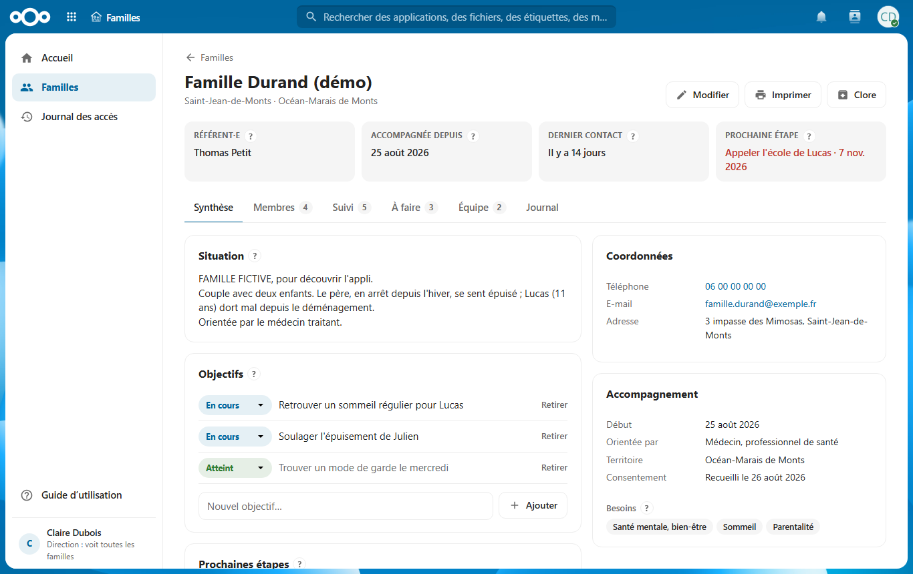
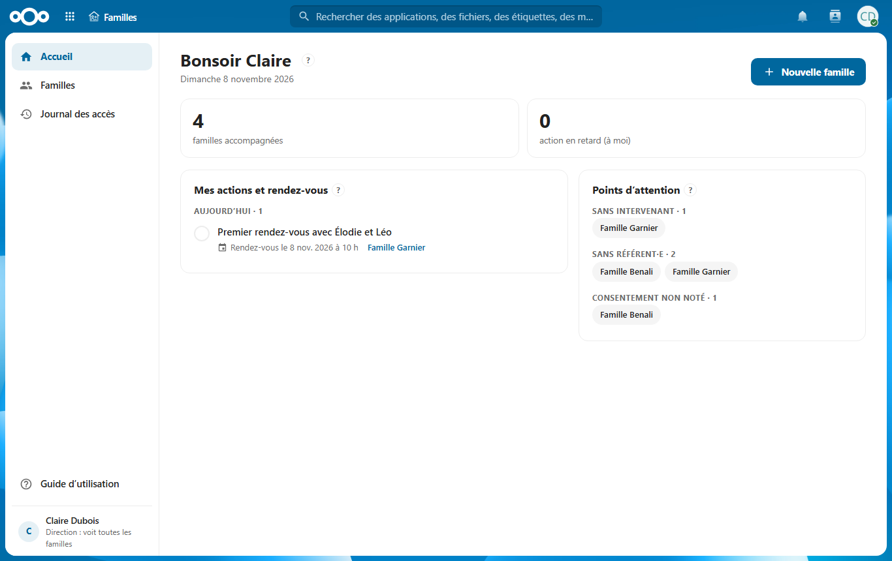
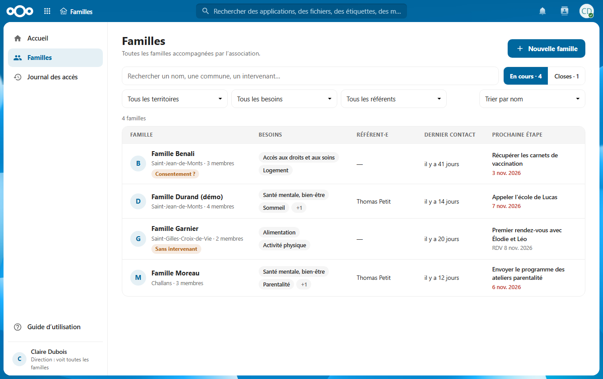
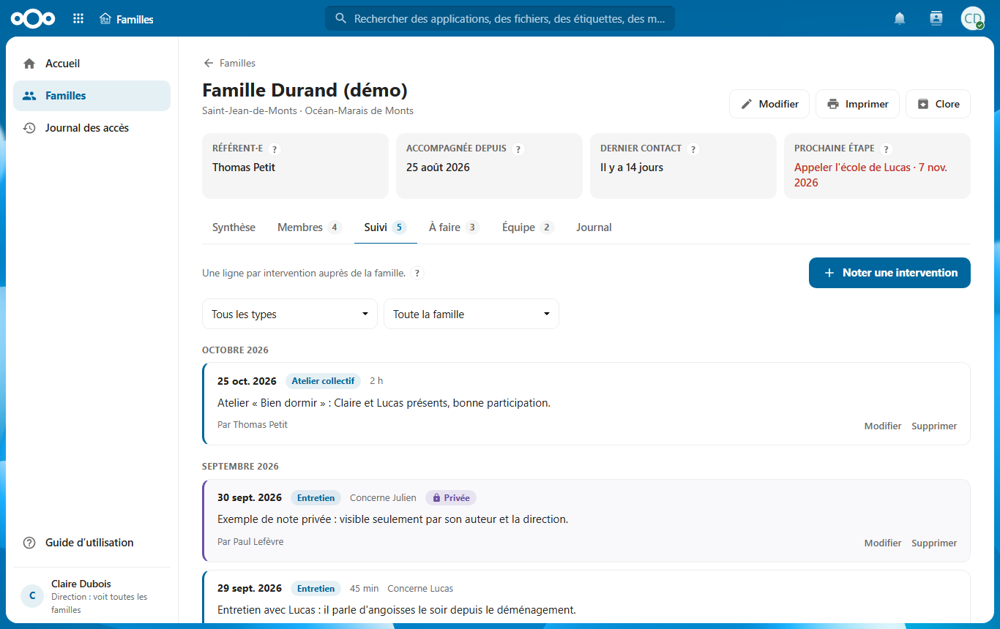
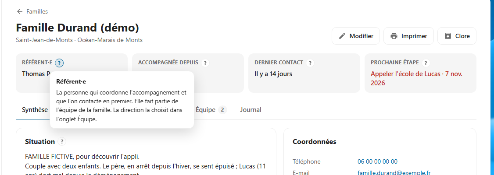

# Familles — le dossier des familles accompagnées, dans Nextcloud

Une appli [Nextcloud](https://nextcloud.com) pour les associations et structures qui
**accompagnent des familles** (prévention santé, soutien à la parentalité, accompagnement social…) :
un dossier par famille, partagé avec les bons intervenants, et seulement eux.



- **Une fiche par famille** : situation, membres (soignants, école, points de vigilance),
  objectifs, coordonnées, consentement.
- **Le suivi** : chaque intervention datée, avec son type et sa durée ; des notes privées
  pour ce qui ne doit pas circuler.
- **À faire** : actions et rendez-vous confiés à une personne de l'équipe, qui est notifiée et
  les retrouve sur son accueil.
- **Accès cloisonné** : chaque intervenant (psychologue, médecin, éducateur…) ne voit **que** les
  familles qui lui sont confiées. Une famille qu'on ne peut pas voir n'existe pas pour nous.
- **Journal** : qui a consulté, imprimé ou modifié quoi, et quand.
- **Facile à prendre en main** : un « ? » à côté de chaque notion, un guide intégré.

| Accueil de chacun | Liste des familles |
|---|---|
|  |  |
| **Le suivi des interventions** | **Une bulle d'aide « ? »** |
|  |  |

## Essayer en 5 minutes

Avec Docker :

```bash
git clone https://github.com/King4Kats/suivi-familles.git
cd suivi-familles
docker compose up --build
```

Puis http://localhost:8150/apps/suivi_familles/ — comptes fictifs `claire` (direction),
`thomas`, `paul`, `marie`, mot de passe `familles2026`. Détails dans [Démarrer](docs/01-demarrer.md).

## Documentation

1. [Démarrer](docs/01-demarrer.md) : la démo, les comptes, installer sur un vrai Nextcloud.
2. [Architecture](docs/02-architecture.md) : le chemin d'une requête, les fichiers, les données (schémas).
3. [Droits et données sensibles](docs/03-droits-et-donnees-sensibles.md) : qui voit quoi, journal, RGPD.
4. [API](docs/04-api.md) : toutes les adresses.
5. [Développer](docs/05-developper.md) : boucle de travail, tests, migrations, conventions.

Le code est commenté en français, paragraphe par paragraphe.

## Compatibilité

Nextcloud 30 à 34 · PHP 8.1+ · aucune dépendance, rien à compiler.

## ⚠ Données de santé

L'appli peut contenir des données de santé. En France, leur hébergement doit être certifié
**HDS**, et le traitement doit respecter le **RGPD** (consentement, durée de conservation…).
L'appli fournit les outils (cloisonnement, journal, consentement, suppression) ; la conformité
reste à la charge de la structure qui l'utilise.

## Licence

[AGPL-3.0-or-later](LICENSE), comme Nextcloud.
